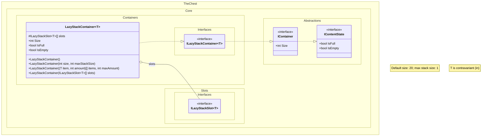
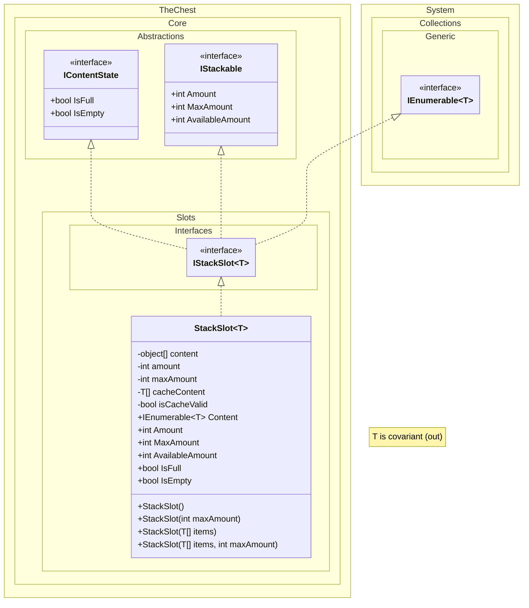
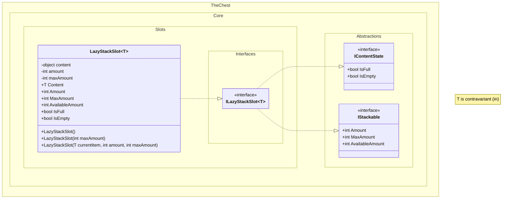

# Class Diagrams

This document contains separate class diagrams for the containers and slots in TheChest.Core.

## Container Diagrams

### Container

```mermaid
---
config:
  theme: mc
  look: classic
  class:
    hideEmptyMembersBox: true
---
classDiagram
direction BT
    namespace TheChest.Core.Abstractions {
        class IContentState {
            <<interface>>
            +bool IsFull
            +bool IsEmpty
        }
        class IContainer {
            <<interface>>
            +int Size
        }
    }
    namespace TheChest.Core.Containers.Interfaces {
        class IContainer~T~ {
            <<interface>>
        }
    }
    namespace System.Collections.Generic {
        class "IEnumerable<IEnumerable<T>>" as IEnumerableOfEnumerableT {
            <<interface>>
        }
    }
    namespace TheChest.Core.Slots.Interfaces {
        class ISlot~T~ {
            <<interface>>
        }
    }
    namespace TheChest.Core.Containers {
        class Container~T~ {
            #ISlot~T~[] slots
            +int Size
            +bool IsFull
            +bool IsEmpty
            +Container()
            +Container(T[] items)
            +Container(int size)
            +Container(T[] items, int size)
            +Container(ISlot~T~[] slots)
        }
    }
    IContainer ..|> IContentState
    IContainer~T~ ..|> IContainer
    IContainer~T~ ..|> IEnumerableOfEnumerableT
    ISlot~T~ ..|> IContentState
    ISlot~T~ ..|> IEnumerableOfEnumerableT
    Container~T~ ..|> IContainer~T~
    Container~T~ o-- ISlot~T~ : slots
    note for IContainer~T~ "T is covariant (out)"
```

### StackContainer

```mermaid
---
config:
  theme: mc
  look: classic
  class:
    hideEmptyMembersBox: true
---
classDiagram
direction BT
    namespace TheChest.Core.Abstractions {
        class IContentState {
            <<interface>>
            +bool IsFull
            +bool IsEmpty
        }
        class IContainer {
            <<interface>>
            +int Size
        }
    }
    namespace TheChest.Core.Containers.Interfaces {
        class IStackContainer~T~ {
            <<interface>>
        }
    }
    namespace System.Collections.Generic {
        class "IEnumerable<IEnumerable<T>>" as IEnumerableOfEnumerableT {
            <<interface>>
        }
    }
    namespace TheChest.Core.Slots.Interfaces {
        class IStackSlot~T~ {
            <<interface>>
        }
    }
    namespace TheChest.Core.Containers {
        class StackContainer~T~ {
            #IStackSlot~T~[] slots
            +int Size
            +bool IsFull
            +bool IsEmpty
            +StackContainer()
            +StackContainer(int size, int maxStackSize)
            +StackContainer(T[] items, int maxStackSize)
            +StackContainer(IStackSlot~T~[] slots)
        }
    }
    IContainer ..|> IContentState
    IStackContainer~T~ ..|> IContainer
    IStackContainer~T~ ..|> IEnumerableOfEnumerableT
    StackContainer~T~ ..|> IStackContainer~T~
    StackContainer~T~ o-- IStackSlot~T~ : slots
    note for IStackContainer~T~ "T is covariant (out)"
```

### LazyStackContainer




## Slot Diagrams

### Slot

```mermaid
---
config:
  theme: mc
  look: classic
  class:
    hideEmptyMembersBox: true
---
classDiagram
direction BT
    namespace TheChest.Core.Abstractions {
        class IContentState {
            <<interface>>
            +bool IsFull
            +bool IsEmpty
        }
    }
    namespace TheChest.Core.Slots.Interfaces {
        class ISlot~T~ {
            <<interface>>
        }
    }
    namespace System.Collections.Generic {
        class "IEnumerable<IEnumerable<T>>" as IEnumerableOfEnumerableT {
            <<interface>>
        }
    }
    namespace TheChest.Core.Slots {
        class Slot~T~ {
            -object content
            +T Content
            +bool IsFull
            +bool IsEmpty
            +Slot()
            +Slot(T currentItem)
        }
    }
    ISlot~T~ ..|> IContentState
    ISlot~T~ ..|> IEnumerableOfEnumerableT
    Slot~T~ ..|> ISlot~T~
    note for ISlot~T~ "T is covariant (out)"
```

### StackSlot



### LazyStackSlot


